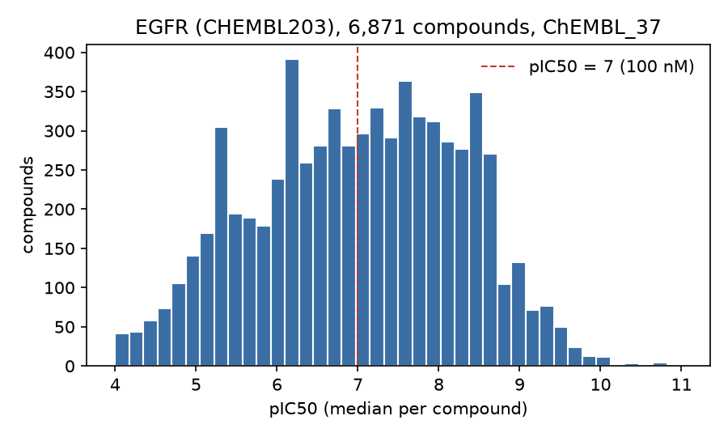

# chembl-easy

**Search ChEMBL and download clean, ML-ready bioactivity data, with fixes for the problems that trip up students and researchers.**

[](https://github.com/hentablihamza/chembl-easy/actions/workflows/ci.yml)
[](https://www.python.org)

[ChEMBL](https://www.ebi.ac.uk/chembl/) is the go-to open source of bioactivity data for QSAR and machine learning. Getting a *clean* dataset out of it is harder than it looks. Requests time out, results come back 20 at a time, "EGFR" matches 18 different targets, the same compound shows up 50 times with values that span six log units, units are mixed, and a SMILES containing `#` silently breaks the URL.

`chembl-easy` turns a gene symbol into a curated, one-row-per-compound table in one command, and it records every filtering step so you can report it in your methods section.

```bash
chembl-easy activities EGFR --types IC50 --min-confidence 9 -o egfr_ic50.csv
```

```
Target: CHEMBL203 | Epidermal growth factor receptor | SINGLE PROTEIN | Homo sapiens (18 candidate target(s) for 'EGFR')
| Step | Rows |
| --- | ---: |
| Server-side match (type/relation/assay type) | 18,454 |
| Downloaded | 18,454 |
| Without curator data-validity flags | 18,189 |
| Without potential duplicates | 16,165 |
| Wild-type assays only (no variant/mutant) | 12,352 |
| Assay confidence score >= 9 | 8,297 |
| With a structure (SMILES) | 8,288 |
| Convertible to p-scale (pIC50/pKi/...) | 8,257 |
| Unique parent compounds | 6,871 |
Wrote 6,871 rows to egfr_ic50.csv
```

*(Real output, ChEMBL 37, November 2026. See the [worked example](#worked-example-egfr-ic50).)*

## The problems, and how chembl-easy solves them

| # | Problem students hit | What chembl-easy does |
| --- | --- | --- |
| 1 | **Timeouts, 502/503/504, `429 Too Many Requests`**, scripts that die halfway through a download | Every request is retried with exponential backoff (`Retry-After` is honoured), with a generous timeout and a small delay between requests |
| 2 | **Re-downloading the same data** every time a notebook is rerun | JSON responses are cached on disk (`~/.cache/chembl-easy`). EGFR took 4 min 16 s and 27 HTTP requests the first time, and 8 s from the cache |
| 3 | **Pagination**: the API returns 20 records per page by default | `paginate()` walks `limit`/`offset` at the 1,000-record maximum (18,454 EGFR records come down in 19 pages) |
| 4 | **Which target is "EGFR"?** A gene-symbol search returns 18 ChEMBL targets: the human single protein, the mouse orthologue, two protein families, a chimera, and many PPI complexes | `find_targets()` accepts a gene symbol, UniProt accession, ChEMBL ID, or free text, and ranks *single protein → complex → family → other* in your organism. `resolve_target()` picks the top one and logs the alternatives |
| 5 | **Downloading everything, then filtering** (slow, and memory-hungry) | Filters on activity type, relation, assay type, and pChEMBL presence run on the server, and only the useful columns are requested (`only=`) |
| 6 | **Assay confidence score** isn't on the activity record | The target's assays are fetched once and joined, so you can keep score 9 (direct single-protein assignment) |
| 7 | **Hidden data-quality flags**: mutant assays, curator-flagged values, re-reported duplicates | Excluded by default (`assay_variant_mutation`, `data_validity_comment`, `potential_duplicate`), each with a `--keep-…` switch. For EGFR they removed 265, 2,024, and 3,813 records respectively |
| 8 | **Mixed units** (`nM`, `uM`, `ug.mL-1`, `%` …) | Everything is converted to nM and then to the p-scale (pIC50/pKi). ChEMBL's curated `pchembl_value` is preferred, and anything that can't be converted safely (EGFR: 23 records in `ug.mL-1`, 7 in odd units) is flagged rather than mixed in |
| 9 | **Repeated measurements**: the same compound appears many times with conflicting values | One row per *parent* compound, with the median plus mean, SD, min, max, number of measurements, assays, and papers, and a `high_variance` flag. Gefitinib has 41 EGFR IC50s spanning pIC50 4.64–10.00 |
| 10 | **Salt forms** counted as different compounds | Records are grouped by `parent_molecule_chembl_id`, and RDKit strips salts and neutralizes the SMILES |
| 11 | **Finding a compound by name**: trade names live in synonyms | `search_molecules("Gleevec")` → CHEMBL941 (imatinib): ChEMBL ID, preferred name, synonym or trade name, then full-text search |
| 12 | **SMILES in URLs**: `similarity/C#C…/80` returns **404** because `#` starts a URL fragment, and `/` or `\` in stereo SMILES break the path | The SMILES is always sent as an encoded query parameter |
| 13 | **An invalid SMILES returns an HTTP 500 traceback**, and a similarity threshold below 40 returns a 400 | The SMILES is validated with RDKit and the threshold checked *before* the request, with a clear error message |
| 14 | **Huge substructure result sets** (a bare quinazoline core reports 30,000 matches) | `max_records` caps the download. Refine the query rather than pulling everything |
| 15 | **Whole-database work** through a REST API | [docs/OFFLINE.md](docs/OFFLINE.md) shows the same query against the ChEMBL SQLite dump, with output that plugs straight into the same functions |
| 16 | **Reproducibility**: "which ChEMBL version was that?" | Every run records the ChEMBL release (`ChEMBL_37`) and the full filtering funnel |

## Installation

**From GitHub (recommended):**

```bash
pip install git+https://github.com/hentablihamza/chembl-easy.git
# Parquet export:
pip install "chembl-easy[parquet] @ git+https://github.com/hentablihamza/chembl-easy.git"
```

**For development:**

```bash
git clone https://github.com/hentablihamza/chembl-easy.git
cd chembl-easy
pip install -e ".[dev]"
```

**With conda:**

```bash
conda env create -f environment.yml
conda activate chembl-easy
```

Requires Python 3.10+. Dependencies are `requests`, `pandas`, `numpy`, and `rdkit`, plus `pyarrow` (optional) for Parquet.

## Command line

```bash
# 1. Which target do I mean?
chembl-easy target EGFR                 # gene symbol
chembl-easy target P00533               # UniProt accession
chembl-easy target "beta-secretase 1"   # free text
chembl-easy target EGFR --single-protein --organism "Mus musculus"

# 2. Download a clean dataset (one row per compound)
chembl-easy activities EGFR --types IC50 --min-confidence 9 -o egfr_ic50.csv
chembl-easy activities CHEMBL4822 --types IC50 Ki --pchembl-only \
    --ml-ready --active-threshold 7 -o bace1.parquet \
    --raw-output bace1_raw.csv --summary bace1_summary.json

# 3. Compounds
chembl-easy molecule Gleevec
chembl-easy similar "C#Cc1cccc(Nc2ncnc3cc(OCCOC)c(OCCOC)cc23)c1" --threshold 80
chembl-easy substructure "c1ccc2ncncc2c1" --max-records 200 -o quinazolines.csv

# 4. Housekeeping
chembl-easy status        # current ChEMBL release and counts
chembl-easy clear-cache
```

Useful `activities` options:

| Option | Default | Meaning |
| --- | --- | --- |
| `--types` | `IC50` | `standard_type` values, e.g. `IC50 Ki Kd EC50` |
| `--assay-types` | `B` | B = binding, F = functional, A = ADMET, T = toxicity, P = physicochemical |
| `--any-relation` | off | keep `<`, `>`, `<=` … (by default only exact `=` values are kept) |
| `--pchembl-only` | off | only records with a curated pChEMBL value |
| `--min-confidence` | none | minimum assay confidence score (9 = direct single protein, 8 = homologous single protein …) |
| `--keep-mutants` / `--keep-flagged` / `--keep-duplicates` | off | turn off the quality filters |
| `--max-range` | `1.0` | flag compounds whose measurements span more log units than this |
| `--drop-high-variance` | off | remove flagged compounds |
| `--ml-ready` | off | write only `compound_id, smiles, p_activity[, active]` |
| `-o` | | `.csv`, `.tsv` or `.parquet` |

Global options: `--cache-dir`, `--no-cache`, `--timeout`, `--retries`, `-v` (log every retry and filter step).

## Python API

```python
from chembl_easy import (
    ChEMBLClient, ActivityQuery, find_targets, build_target_dataset,
    search_molecules, similarity_search, ml_ready, save_table,
)

client = ChEMBLClient()                          # retries + disk cache

find_targets("EGFR", client=client).head()       # inspect candidates first

ds = build_target_dataset(
    "EGFR",
    query=ActivityQuery(standard_types=["IC50"], assay_types=["B"], min_confidence=9),
    client=client,
)
print(ds.report.to_markdown())                   # filtering funnel for your methods section
print(ds.summary())                              # counts, pIC50 range, ChEMBL release
save_table(ml_ready(ds.clean, threshold=7.0), "egfr_ml.csv")

search_molecules("Gleevec", client=client)
similarity_search("CC(=O)Oc1ccccc1C(=O)O", threshold=70, client=client)
```

Each step is also available on its own: `fetch_activities`, `harmonize_units`, `aggregate_by_compound`, `to_nM`, `nM_to_p`, `validate_smiles`, and `parent_smiles`.

### Output columns (`ds.clean`)

| Column | Meaning |
| --- | --- |
| `compound_id` | parent molecule ChEMBL ID (salt forms merged) |
| `smiles` | RDKit canonical SMILES, largest fragment, neutralized |
| `p_activity` | median p-value (pIC50, pKi …) across measurements |
| `p_activity_mean`, `p_activity_std`, `p_activity_min`, `p_activity_max` | spread of the measurements |
| `n_measurements`, `n_assays`, `n_documents` | how much evidence there is |
| `standard_types` | e.g. `IC50` or `IC50;Ki` |
| `first_year` | first publication year (useful for time splits) |
| `high_variance` | max − min > `max_range` log units |

## Worked example: EGFR IC50

[`examples/egfr_example.py`](examples/egfr_example.py) builds the dataset end to end. These numbers come from a real run against ChEMBL 37 on 24 November 2026:

- **Target resolution:** "EGFR" matched **18** ChEMBL targets. CHEMBL203 (human, single protein) was picked ahead of 2 protein families, a chimera, 13 PPI complexes, and the mouse orthologue.
- **Filtering funnel:** 18,454 binding IC50 records with `=` → **8,257** usable measurements → **6,871 unique parent compounds** (table at the top of this page).
- **Repeated measurements:** 1,005 compounds have more than one measurement. 199 are flagged `high_variance` (range > 1 log unit). Erlotinib (CHEMBL553) has 52 measurements, with a median pIC50 of 7.21 and a range of 5.21–10.54. Gefitinib (CHEMBL939) has 41, with a median of 7.57 and a range of 4.64–10.00.
- **Activity distribution:** median pIC50 **7.05** (range 4.0–11.0). 5,297 compounds have pIC50 ≥ 6 (≤ 1 µM), and 3,562 have pIC50 ≥ 7 (≤ 100 nM).
- **Units in the raw records:** 8,258 nM, 23 `ug.mL-1`, 6 `/uM`, 1 `10^3 uM`. Only the molar values were used.
- **Cost:** 27 HTTP requests and 4 min 16 s on the first run, 8 s from the cache.



Outputs are in [`examples/egfr/`](examples/egfr/): `egfr_ic50_compounds.csv` (all columns), `egfr_ic50_ml.csv` (`compound_id, smiles, p_activity, active`), `summary.json`, and `funnel.md`. The ML table drops straight into [qsar-split-bench](https://github.com/hentablihamza/qsar-split-bench) to check how much a random split overstates model performance.

## Good practice when using ChEMBL data

- **Look at the target candidates before downloading.** Protein families and complexes mix several proteins' data.
- **Don't mix activity types blindly.** IC50 depends on assay conditions, and Ki doesn't. Merge them only if you can justify it, and keep `standard_types` to check.
- **Keep the default `=` relation for regression.** Censored values (`>10 µM`) are useful for classification, but they aren't exact numbers.
- **Report the funnel and the ChEMBL release.** `--summary` writes both to JSON.
- **Split by scaffold or by time, not randomly.** Related compounds from the same paper are highly similar (see qsar-split-bench).

## Testing

```bash
pytest -v                                         # offline: all HTTP is mocked
CHEMBL_EASY_NETWORK_TESTS=1 pytest -m network     # optional live checks against ChEMBL
```

The suite covers retries and backoff, `Retry-After`, caching, pagination, target ranking, quality filters, unit conversion, aggregation, salt stripping, SMILES validation, export formats, and the CLI. CI runs it on every push without touching the network.

## Project layout

```
src/chembl_easy/
  client.py      retrying, caching, rate-limited HTTP client + pagination
  targets.py     gene symbol / UniProt / ChEMBL ID / text -> ranked targets
  activities.py  server-side filters, assay confidence, quality flags, funnel report
  units.py       unit conversion to nM and p-scale
  aggregate.py   one row per parent compound, variance flags
  molecules.py   name / synonym / similarity / substructure search
  chem.py        RDKit SMILES validation and salt stripping
  export.py      CSV / TSV / Parquet, ML-ready table
  pipeline.py    build_target_dataset(): everything in one call
  cli.py         chembl-easy command
examples/egfr_example.py   worked example (outputs in examples/egfr/)
docs/OFFLINE.md            using the ChEMBL SQLite dump
```

## Data attribution

ChEMBL data is provided by EMBL-EBI under a Creative Commons Attribution-ShareAlike 3.0 Unported licence. The example tables in `examples/egfr/` are derived from ChEMBL release 37 and keep the ChEMBL IDs. If you use ChEMBL data, please cite:

> Mendez D. *et al.* ChEMBL: towards direct deposition of bioassay data. *Nucleic Acids Res.* 2019, 47(D1), D930–D940. doi:[10.1093/nar/gky1075](https://doi.org/10.1093/nar/gky1075)

`chembl-easy` is an independent project and isn't affiliated with or endorsed by EMBL-EBI.

## Citation

If `chembl-easy` helps your research, please cite it with the metadata in [`CITATION.cff`](CITATION.cff) (GitHub's "Cite this repository" button).

## Author

**Hamza Hentabli, Ph.D.**, AI/ML drug discovery and cheminformatics
[Google Scholar](https://scholar.google.com/citations?user=-7dUlnMAAAAJ) · [ORCID](https://orcid.org/0000-0002-9530-2815) · [LinkedIn](https://www.linkedin.com/in/hentabli-hamza-ph-d-99192a101) · [GitHub](https://github.com/hentablihamza)
